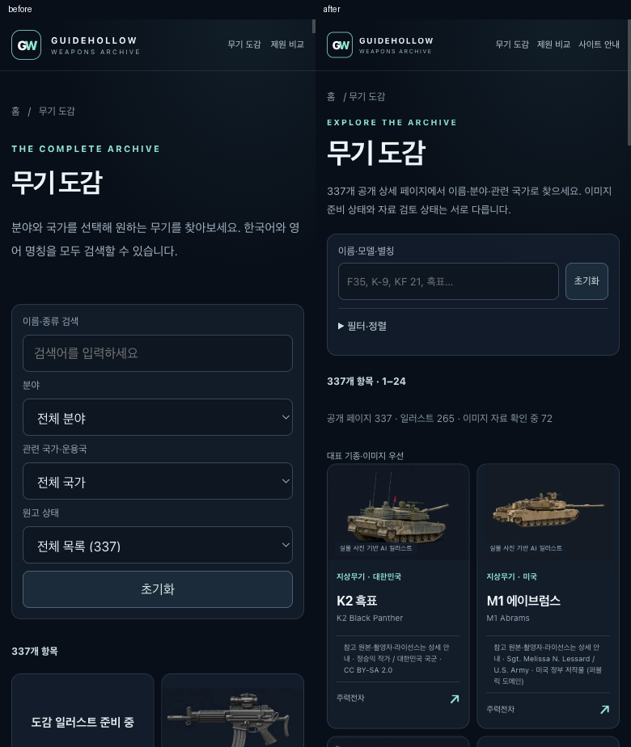

# 탐색·비교 개선 검증 보고서

대상 `emfls/guidehollow-weapons`, 기준 커밋 `4036baa36d101713409fd2822c036d2c10cdf10f`.
작업 브랜치 `codex/weapons-discovery-comparison-20261107`. main 직접 push·병합·배포는 하지 않는다.

## 변경 파일과 해결한 문제

- `data/catalog.json`, `assets/catalog-core.js`, `scripts/build.mjs`, `templates/home.html`: 공개 337종·분야 합계·홈·정적 목록을 같은 데이터에서 생성한다. 초기 24개 페이지 분할, 337개 정적 이름 링크, 작은 이미지 대기 카드, 대표 기종·이미지 우선/이름순을 적용했다.
- `assets/site.js`: 모델 표기 정규화, 한국어·영문·slug·기존 별칭 검색, 명시된 관련 국가 집합, 검색·필터·정렬·페이지 URL 및 뒤로가기 복원. 관련 국가를 개발국으로 재분류하지 않는다.
- `data/editorial.json`, M1/F-35 본문, `assets/editorial.js`: 직접 확인한 공식 자료 17개와 형식별 프로필 7개. K2, 미군/호주군 M1A2 SEPv3, F-35A/B/C, K9 기본형을 구분하며 본문과 비교에서 같은 프로필을 사용한다. 나머지 335개 본문 main은 기준 커밋과 바이트 동일하다.
- `assets/style.css`, 홈·목록·비교·대표 본문: 기존 네이비·민트와 contain 이미지를 유지한다. AI 이미지 표기·크레딧, 접는 필터, 44px 조작 목표, 포커스, 의미 있는 표와 표 영역 내부 가로 스크롤을 적용했다.
- 전체 343개 HTML: 공유 에셋 해시, 일관된 상세 메타, 실제 보이는 내용에 맞는 TechArticle/BreadcrumbList. 작성자·최초 발행일을 만들어 넣지 않았다. 기존 335개 본문의 자료 검토일을 보존하고 실제 검토한 대표 2개만 갱신했다.
- `tests/`, `scripts/validate.py`, `.github/workflows/quality.yml`: 회귀·정적·생성물 일치 검사. 기존 main 배포 워크플로·CNAME·robots·사이트맵·265개 이미지 바이너리는 변경하지 않았다.

## 실제 실행한 검증

- `node --test tests/*.test.cjs`: **21/21 PASS**. 검색·국가·URL·분할·새 항목 개수·형식/측정 기준·출처·페이지 초점·비교 뒤로가기 회귀.
- `node scripts/build.mjs --check`: **345개 생성 파일 일치**.
- `python3 scripts/validate.py`: **343경로·337페이지·265이미지**, 정적 링크·메타·출처·검토일·공유 에셋 해시 PASS. JS 문법·Git 공백 검사 PASS.
- 실제 Chrome 기능 검증 **35건 PASS**: 검색 표기, 국가·이미지·분야, 초기화, 복합 국가의 옛 URL, 페이지 2→상세→뒤로가기, 검색 popstate, 비교 검색·형식·교환·공유·새로고침, 키보드, JavaScript 비활성 상태의 337개 링크와 실제 클릭. 기록: [functional-browser.json](functional-browser.json).
- 독립 리뷰의 키보드 초점·비교 기록 문제를 실제 브라우저에서 재현한 뒤 수정했다. 기록: [수정 전](review-regressions-before.json) / [수정 후](review-regressions-after.json).
- 360/390/768/1440px, 5개 대표 화면 총 **20화면**: 바깥 가로 넘침 0, 콘솔·이미지 오류 0. 360/390px의 측정 대상 주요 조작 요소 44px 미달 0. 모바일 표의 고정 항목명과 한 대상 셀이 함께 완전히 들어오는 너비, 키보드 가로 스크롤 확인.
- 독립 리뷰의 중요 3건과 출처 설명 1건을 한 수정 패스에서 처리했다. 새 회귀 5개 실패 확인 → 전체 21개 통과. 페이지 초점, 비교 편집 플래그 복원, 너비 의미 확장, NAVAIR 출처 설명 불일치를 수정했다.

## 변경 전후 화면

| 화면 | 너비 | 변경 전 | 변경 후 |
|---|---:|---|---|
| 홈 | 360 | [PNG](screenshots/before-home-360.png) | [PNG](screenshots/after-home-360.png) |
| 홈 | 390 | [PNG](screenshots/before-home-390.png) | [PNG](screenshots/after-home-390.png) |
| 홈 | 768 | [PNG](screenshots/before-home-768.png) | [PNG](screenshots/after-home-768.png) |
| 홈 | 1440 | [PNG](screenshots/before-home-1440.png) | [PNG](screenshots/after-home-1440.png) |
| 도감 | 360 | [PNG](screenshots/before-atlas-360.png) | [PNG](screenshots/after-atlas-360.png) |
| 도감 | 390 | [PNG](screenshots/before-atlas-390.png) | [PNG](screenshots/after-atlas-390.png) |
| 도감 | 768 | [PNG](screenshots/before-atlas-768.png) | [PNG](screenshots/after-atlas-768.png) |
| 도감 | 1440 | [PNG](screenshots/before-atlas-1440.png) | [PNG](screenshots/after-atlas-1440.png) |
| 비교 | 360 | [PNG](screenshots/before-compare-360.png) | [PNG](screenshots/after-compare-360.png) |
| 비교 | 390 | [PNG](screenshots/before-compare-390.png) | [PNG](screenshots/after-compare-390.png) |
| 비교 | 768 | [PNG](screenshots/before-compare-768.png) | [PNG](screenshots/after-compare-768.png) |
| 비교 | 1440 | [PNG](screenshots/before-compare-1440.png) | [PNG](screenshots/after-compare-1440.png) |
| M1 | 360 | [PNG](screenshots/before-m1-360.png) | [PNG](screenshots/after-m1-360.png) |
| M1 | 390 | [PNG](screenshots/before-m1-390.png) | [PNG](screenshots/after-m1-390.png) |
| M1 | 768 | [PNG](screenshots/before-m1-768.png) | [PNG](screenshots/after-m1-768.png) |
| M1 | 1440 | [PNG](screenshots/before-m1-1440.png) | [PNG](screenshots/after-m1-1440.png) |
| F-35 | 360 | [PNG](screenshots/before-f35-360.png) | [PNG](screenshots/after-f35-360.png) |
| F-35 | 390 | [PNG](screenshots/before-f35-390.png) | [PNG](screenshots/after-f35-390.png) |
| F-35 | 768 | [PNG](screenshots/before-f35-768.png) | [PNG](screenshots/after-f35-768.png) |
| F-35 | 1440 | [PNG](screenshots/before-f35-1440.png) | [PNG](screenshots/after-f35-1440.png) |

모바일 비교표: [첫 대상](screenshots/after-compare-table-360.png) / [가로 이동 후 둘째 대상과 고정 항목명](screenshots/after-compare-table-scrolled-360.png).

## 측정 환경과 결과

로컬 macOS Chrome 154, 동일 브라우저·CPU, HTTP localhost의 변경 전 8767/변경 후 8768 포트, 1440×900, 배율 1. 캐시 비활성, 네트워크·CPU 인위 제한 없음. 첫 뷰포트 이미지가 로드된 뒤 한 번 관측했다. HTML은 실제 파일 바이트, DOM·그림 요청/전송량은 브라우저 실측이다. 리뷰 후 의미·기록 수정은 노드/그림 구성을 바꾸지 않았으며 HTML 크기는 최종 파일 기준이다. 공개 HTTPS 서버 속도·LCP·CWV 개선으로 일반화하지 않는다.

| 페이지 | DOM 전→후 | HTML바이트 전→후 | 초기 그림요청 전→후 | 초기 그림전송바이트 전→후 |
|---|---:|---:|---:|---:|
| 홈 | 518 → 293 | 31,998 → 17,788 | 12 → 10 | 908,334 → 611,218 |
| 도감 | 4,168 → 1,091 | 275,150 → 48,806 | 13 → 16 | 1,188,682 → 1,514,270 |
| 비교 | 812 → 941 | 8,224 → 55,312 | 2 → 2 | 146,086 → 146,086 |
| M1 | 181 → 381 | 9,295 → 28,552 | 1 → 1 | 58,846 → 58,846 |
| F-35 | 193 → 503 | 10,555 → 33,294 | 1 → 1 | 18,916 → 18,916 |

도감 HTML·DOM은 줄었지만 첫 화면에서 볼 수 있는 준비된 그림이 늘면서 이 실측의 그림 전송량은 증가했다. 비교·대표글은 출처가 있는 정적 표·본문이 추가되어 HTML이 증가했다. 전체 속도가 빨라졌다고 주장하지 않는다. 원자료: [performance-summary.json](performance-summary.json), [before-browser.json](before-browser.json), [after-browser.json](after-browser.json).

## 남은 미확인 사항

- 전체 337종 심층 사실검증을 완료한 결과가 아니다. 본문 보강은 M1/F-35 두 문서, 형식별 자료는 명시한 7개 프로필 범위다. 기존 기본 facts는 별도 펼침 정보로 보존하고 검증된 수치처럼 합치지 않는다.
- 미군 SEPv3의 `73.6 tons`는 short/metric 구분이 원문에 없어 정밀 전투중량으로 환산하지 않았다. 단순 Weight·일반지형속도·원문 Speed는 전투중량·포장도로최고속도와 별도다. F-35B/C 명시 MTOW 등 미수집값은 채우지 않았다.
- 독립 코드 리뷰는 외부 원문을 모두 다시 검증한 것이 아니다. 공식 자료는 이번 연구에서 직접 열람한 범위이며, 기관 홈페이지 링크만으로 수치를 검증했다고 하지 않았다. 실기기·다른 브라우저·운영 HTTPS 성능은 측정하지 않았다.
- 이미지 자료 확인 중 72종은 유지했다. 미검수·다른 기종 그림을 넣거나 이미지 때문에 문서를 삭제·noindex 처리하지 않았다.
- 스크린샷 속 개별 일러스트에는 각 상세 페이지의 원본·저작자·라이선스 조건이 적용된다.
